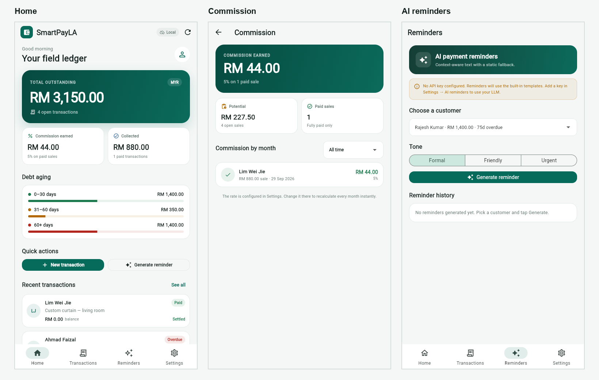

# SmartPayLA

A Flutter prototype of the **Core Transaction Engine and AI-Powered Reminder Generation** module for SmartPayLA: a field ledger that helps sales agents record credit sales, track balances and debt aging, verify commission, and generate payment reminders.

This repository is the implementation for the FYP report. The core increments are complete and runnable; the partner integration contract is documented.



## What works

### Transactions and dashboard
- Create, edit and delete a transaction (customer, item, total, advance, due date, finish date, claim expiry, invoice/cash-bill reference).
- Automatic **balance due** (`total - advance`) and **payment status** (Unpaid / Partial / Paid).
- **Overdue** is derived from the due date; the UI shows days overdue and the aging bucket (0–30, 31–60, 60+ days).
- Search by customer, item, invoice or cash-bill number; filter by status/overdue.
- **Bill month/year filter** (cash-bill date → invoice date → record date), with newest bill first inside the selected month.
- Home dashboard: total outstanding, commission, collected amount, aging breakdown, recent transactions.

### Commission (Increment 3)
- Commission engine computes earned commission on fully paid transactions and potential commission on open sales.
- **Commission screen** with all-time/monthly view, per-sale lines, rate display.
- Commission rate in Settings recalculates every view instantly.
- Pure-Dart engine in `lib/services/commission_engine.dart` with unit tests.

### AI reminders (Increment 4)
- Pick an open/overdue customer, choose **Formal / Friendly / Urgent**, generate a reminder.
- **Shared AI proxy**: every user can generate reminders without buying a DeepSeek key. The app calls a Cloudflare Worker; the Worker holds `DEEPSEEK_API_KEY` and calls `deepseek-chat`.
- **12-second timeout** and **static fallback templates** when the proxy is unavailable or returns an error.
- Preview, copy to clipboard, and local reminder history.
- Settings → AI reminders only chooses the default tone; there is no API-key field for users.
- The partner module owns WhatsApp sharing and the cross-device reminder history UI.
- Current proxy: `https://smartpayla-ai.changvui12.workers.dev` (already wired into the local runner and the GitHub Actions build).
- Worker source: `server/worker.js`. Deployment guide: [docs/AI_PROXY.md](docs/AI_PROXY.md).

### Cloud sync (Increment 2)
- Offline-first architecture: local storage is the cache; Firestore is optional.
- `users/{userId}/transactions/{transactionId}` Firestore layout, merge by `updatedAt`, real-time snapshot listener, and a **sync badge** (Local / Syncing / Synced / Sync error).
- The Firestore owner comes from `FirebaseAuth.currentUser.uid` when someone is signed in; `APP_USER_ID` is only the test-mode fallback.
- Runs fully in local mode without Firebase. Add `FIREBASE_*` defines to enable sync.
- See [docs/FIREBASE.md](docs/FIREBASE.md).

### Partner integration (Increment 5)
- Read-only Riverpod providers for transactions, commission, overdue accounts and reminder history.
- Payload helpers and a Firestore/JSON data contract.
- See [docs/INTEGRATION.md](docs/INTEGRATION.md).

## Run it

### 1. Install the tools

**Recommended: VS Code + Flutter SDK** (lighter than Android Studio).

1. Install [VS Code](https://code.visualstudio.com/).
2. Install the **Flutter** extension (it also installs **Dart**).
3. Install the Flutter SDK from <https://docs.flutter.dev/get-started/install/windows>.
4. Add `flutter\bin` to your `PATH`, then run `flutter doctor`.

On this machine the SDK is already extracted at:

```text
C:\Users\chang\Desktop\DSH\flutter
```

so the session `PATH` needs:

```powershell
$env:Path = "C:\Users\chang\Desktop\DSH\flutter\bin;" + $env:Path
```

Android Studio is **optional**. Install it only for an Android emulator or Play Store build. For UI work and demos, Chrome is enough.

### 2. Run the app

```powershell
cd C:\Users\chang\Desktop\DSH\FYP\smartpayla
flutter pub get
flutter run -d chrome
```

With sample data:

```powershell
flutter run -d chrome --dart-define=DEMO=true
```

The demo flag only seeds data when the local ledger is empty.

### 3. Enable Firestore (optional)

Follow [docs/FIREBASE.md](docs/FIREBASE.md). Short version:

```powershell
flutter run -d chrome `
  --dart-define=FIREBASE_API_KEY=... `
  --dart-define=FIREBASE_APP_ID=... `
  --dart-define=FIREBASE_MESSAGING_SENDER_ID=... `
  --dart-define=FIREBASE_PROJECT_ID=... `
  --dart-define=APP_USER_ID=demo-agent `
  --dart-define=DEMO=true
```

Without these values the app stays in local mode and the badge shows **Local**.

For the `smartpayla-fyp` project, the helper `tools/run_firebase.ps1` already contains the public web config and prompts for the test email/password:

```powershell
.\tools\run_firebase.ps1
```

### 4. Put it on your iPhone without the App Store (PWA)

Windows cannot build a native iOS app — that needs macOS + Xcode. For the FYP demo, use the Flutter **web build** as a home-screen app:

```powershell
flutter build web --release --dart-define=DEMO=true
cd build\web
python -m http.server 8080 --bind 0.0.0.0
```

Open `http://<PC-IP>:8080` in **Safari**, then **Share → Add to Home Screen**. Android Chrome uses **Add to Home screen / Install app**.

For a permanent free link that updates on every push, see [docs/DEPLOY.md](docs/DEPLOY.md) (GitHub Pages + Actions). The workflow is at `.github/workflows/deploy.yml`.

## Test and check

```powershell
flutter analyze
flutter test
```

Expected: `No issues found!` and **19 tests passed**.

## Project structure

```text
lib/
  main.dart                        app bootstrap, optional Firebase init, demo seed
  app.dart                         MaterialApp
  theme.dart                       colours and Material 3 theme
  models/
    transaction.dart               Transaction, PaymentStatus, AgingBucket
    reminder.dart                  ReminderTone, ReminderResult, ReminderRecord
  data/
    transaction_repository.dart    local repository + demo seed
    firestore_transaction_repository.dart
    firebase_config.dart           dart-define config + runtime flag
  services/
    commission_engine.dart         pure commission calculation
    reminder_service.dart          LLM call + fallback templates
    cloud_sync_service.dart        local/Firestore merge + sync status
  state/providers.dart             Riverpod providers and notifiers
  integration/partner_bridge.dart  read-only partner contract
  screens/
    home_shell.dart                bottom navigation shell
    home_screen.dart               dashboard
    transactions_screen.dart       list, search, filters, bill-month picker
    transaction_form_screen.dart   add/edit form + validation
    transaction_detail_screen.dart detail, payment update, delete
    commission_screen.dart         monthly commission view
    reminders_screen.dart          AI reminder composer + history
    settings_screen.dart           commission, AI, cloud sync, data
  widgets/
    common.dart                    cards, pills, formatting, layout
    transaction_tile.dart          list row
    sync_badge.dart                Local / Syncing / Synced / Error
test/
  transaction_test.dart            money, aging, bill date, JSON, repository
  commission_test.dart             commission engine
  reminder_test.dart               fallback + mocked LLM
  month_filter_test.dart           bill-month filter widget test
  reminder_screen_test.dart        fallback reminder UI
  widget_test.dart                 app smoke test
docs/
  UI_DESIGN.md                     screen map and visual system
  FIREBASE.md                      Firestore setup and rules
  INTEGRATION.md                   partner contract
  DEPLOY.md                        GitHub Pages + Netlify
```

## Design decisions

- **Repository boundary.** Screens depend on repositories/providers, not on storage details. The local and Firestore stores share the same JSON.
- **Derived overdue.** `PaymentStatus` stores only Unpaid / Partial / Paid; “Overdue” is computed from `dueDate`, so it cannot become stale.
- **Bill month uses the document date.** The month filter and commission period use `cashBillDate`, then `invoiceDate`, then `createdAt`.
- **Offline first.** Every write hits the local cache first; Firestore is a background sync target. The app never blocks on the network.
- **AI with a floor.** The reminder always produces a usable message; the LLM is an enhancement, not a single point of failure.
- **Pure business logic.** `CommissionEngine` and `ReminderService` are testable without widgets or Firebase.

## Scope

Implemented in this module: transactions, payment status/aging, dashboard, commission, AI reminder generation, state exposure, Firestore-ready sync.

Partner module (Kerry), intentionally not implemented here: authentication UI, customer profiles, OCR/receipt image management, reminder message management/WhatsApp sharing, shared settings screen.

## Deploy

- [GitHub Pages + Actions](docs/DEPLOY.md) — free permanent URL, auto-deploy on `git push`.
- Netlify Drop: drag `build/smartpayla-web.zip` into <https://app.netlify.com/drop> for a permanent HTTPS link without a server.
