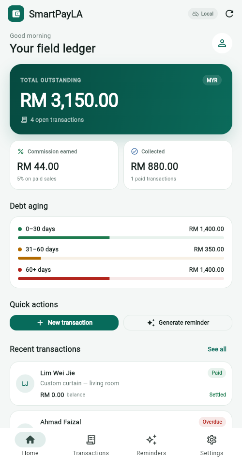
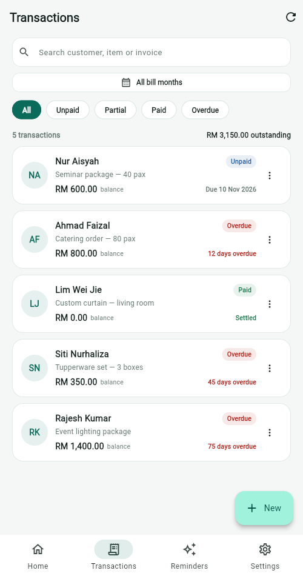
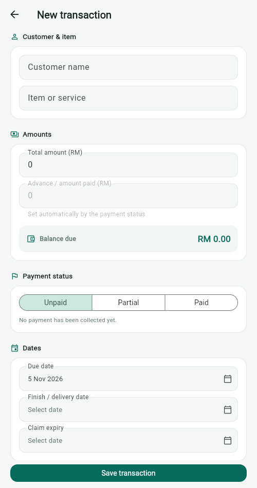

# SmartPayLA

A Flutter prototype of the **Core Transaction Engine** for SmartPayLA: a field ledger that helps sales agents record credit sales, track balances and debt aging, and see commission earned.

This repository is the implementation for the FYP report. It is built incrementally; **Increment 1** is complete and runnable.



## Increment 1 — what works

- Create, edit and delete a transaction (customer, item, total, advance, due date, finish date, claim expiry, invoice/cash-bill reference).
- Automatic **balance due** (`total - advance`) and **payment status** (Unpaid / Partial / Paid).
- **Overdue** is derived from the due date; the UI shows the days overdue and the aging bucket (0–30, 31–60, 60+ days).
- Search by customer, item, invoice or cash-bill number; filter by status/overdue.
- **Bill month/year filter** (cash-bill date → invoice date → record date), with newest bill first inside the selected month.
- Home dashboard: total outstanding, commission earned, collected amount, aging breakdown, recent transactions.
- Detail screen: payment breakdown, status update, record a partial payment, edit and delete.
- Commission rate setting (default 5%) persisted locally.
- Local persistence through `shared_preferences`; the app survives a browser refresh or app restart.
- Demo mode with five sample transactions.
- 12 unit/widget tests; `flutter analyze` is clean.

| Home | Transactions | New transaction |
|---|---|---|
|  |  |  |

## Run it

### 1. Install the tools

**Recommended: VS Code + Flutter SDK** (lighter than Android Studio).

1. Install [VS Code](https://code.visualstudio.com/).
2. In VS Code, install the **Flutter** extension (it also installs **Dart**).
3. Install the Flutter SDK from <https://docs.flutter.dev/get-started/install/windows>.
4. Add `flutter\bin` to your `PATH`, then check:

```powershell
flutter doctor
```

On this machine the SDK is already extracted at:

```text
C:\Users\chang\Desktop\DSH\flutter
```

so the session `PATH` needs:

```powershell
$env:Path = "C:\Users\chang\Desktop\DSH\flutter\bin;" + $env:Path
```

Android Studio is **optional**. Install it only when you want an Android emulator or a Play Store build. For UI work and demos, Chrome is enough.

### 2. Run the app

```powershell
cd C:\Users\chang\Desktop\DSH\FYP\smartpayla
flutter pub get
flutter run -d chrome
```

With sample data:

```powershell
flutter run -d chrome --dart-define=DEMO=true
```

The demo flag only seeds data when the local ledger is empty. Clear it from **Settings → Clear all transactions** or use a fresh browser profile.

### 3. Run on an Android emulator (optional)

Install Android Studio, open **Device Manager**, create a Pixel emulator, start it, then:

```powershell
flutter devices
flutter run -d emulator-5554
```

### 4. Put it on your iPhone without the App Store (PWA)

Windows cannot build a native iOS app — that needs macOS + Xcode. For the FYP demo, use the Flutter **web build** as a home-screen app:

```powershell
flutter build web --release --dart-define=DEMO=true
cd build\web
python -m http.server 8080 --bind 0.0.0.0
```

Find your PC's Wi-Fi IP with `ipconfig`, then on the iPhone (same Wi-Fi):

1. Open `http://<PC-IP>:8080` in **Safari**.
2. Tap **Share → Add to Home Screen**.
3. It opens full-screen like an app; no App Store, no 7-day expiry.

For a public demo, deploy `build/web` to Firebase Hosting, Netlify or GitHub Pages and open that URL on the iPhone.

**No server needed:** drag `build/smartpayla-web.zip` into <https://app.netlify.com/drop>. Netlify gives a permanent HTTPS URL that works on iPhone Safari and Android Chrome, even when this PC is off.

**Native iOS install** (if the faculty insists): you need a Mac with Xcode. A free Apple ID can sideload the app for 7 days; TestFlight/Ad Hoc needs the Apple Developer Program. The Flutter code is already cross-platform, so no rewrite is needed — only a macOS build machine.

## Test and check

```powershell
flutter analyze
flutter test
```

Expected: `No issues found!` and `All tests passed!` (12 tests).

## Project structure

```text
lib/
  main.dart                       app bootstrap + optional demo seed
  app.dart                        MaterialApp
  theme.dart                      colours and Material 3 theme
  models/transaction.dart         Transaction, PaymentStatus, AgingBucket
  data/transaction_repository.dart repository interface + local storage
  state/providers.dart            Riverpod providers and notifiers
  screens/
    home_shell.dart               bottom navigation shell
    home_screen.dart              dashboard
    transactions_screen.dart      list, search, filters, bill-month picker
    transaction_form_screen.dart  add/edit form + validation
    transaction_detail_screen.dart detail, payment update, delete
    reminders_screen.dart         Increment 4 placeholder
    settings_screen.dart          commission rate, demo data, about
  widgets/
    common.dart                   cards, status pill, formatting, layout
    transaction_tile.dart         list row
test/
  transaction_test.dart           money, aging, bill date, JSON, repository
  month_filter_test.dart          bill-month filter widget test
  widget_test.dart                app smoke test
```

## Design decisions

- **Repository boundary.** Screens depend on `TransactionRepository`, not on `shared_preferences`. Increment 2 adds `FirestoreTransactionRepository` and changes only the provider override.
- **Derived overdue.** `PaymentStatus` stores only Unpaid / Partial / Paid; “Overdue” is computed from `dueDate`, so it cannot become stale.
- **Bill month uses the document date.** The month filter uses `cashBillDate`, then `invoiceDate`, then `createdAt`. This keeps old records visible even when the physical document date was not entered.
- **Phone-first, web-safe.** `PageWidth` caps content at 560 px on tablets/browsers; the layout stays single-column.
- **Local first.** Increment 1 works offline with no Firebase project, so the UI and business rules can be tested before cloud setup.

## Not in Increment 1

- Firebase Authentication and Firestore sync (Increment 2).
- Full commission engine and commission history (Increment 3).
- LLM reminder generation and reminder history (Increment 4).
- Customer profiles, OCR receipt scanning and settings from the partner module.
- PDF/Excel export, multi-currency, multi-user roles.

## Next increments

| Increment | Scope |
|---|---|
| 2 | Firestore repository, offline sync, dashboard hardening |
| 3 | Commission engine, rate history, monthly commission view |
| 4 | LLM prompt construction, tone selection, fallback template, reminder history |
| 5 | Integration with the partner's auth/customer/reminder modules, end-to-end testing |

See [docs/UI_DESIGN.md](docs/UI_DESIGN.md) for the screen map and design system.
See [docs/DEPLOY.md](docs/DEPLOY.md) for the free, permanent GitHub Pages setup with auto-deploy on every push.
